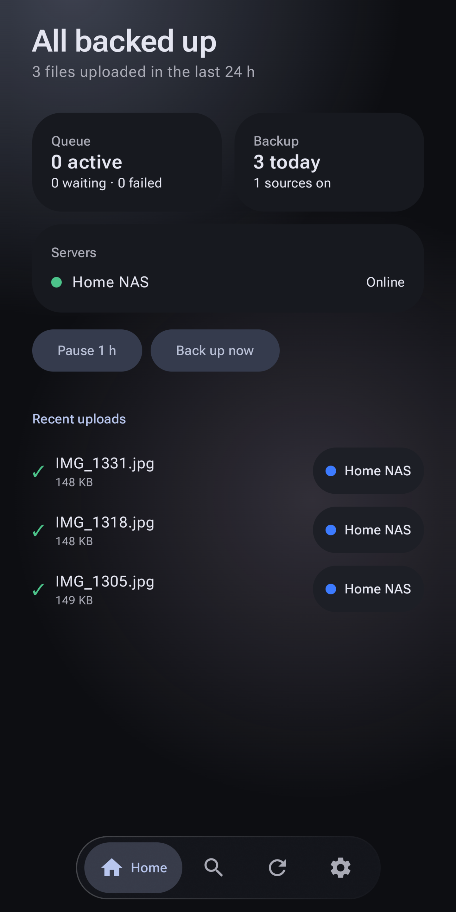
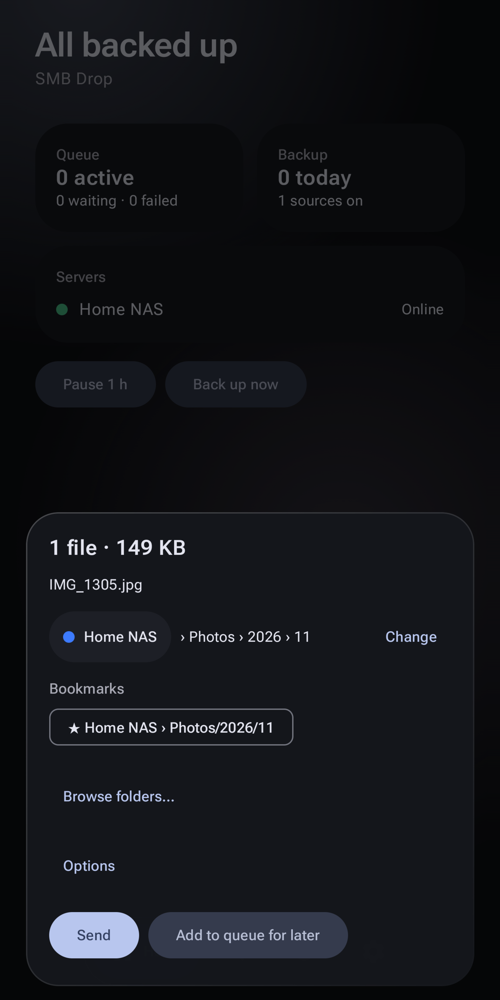
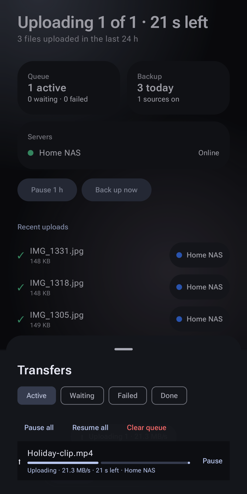
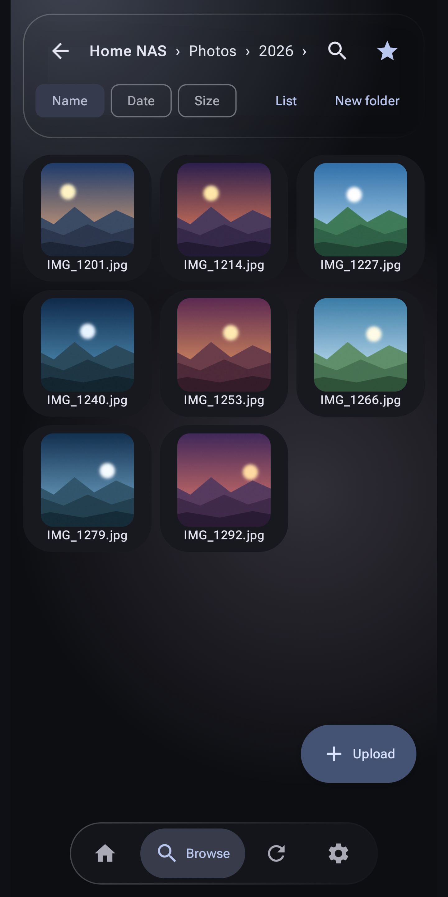
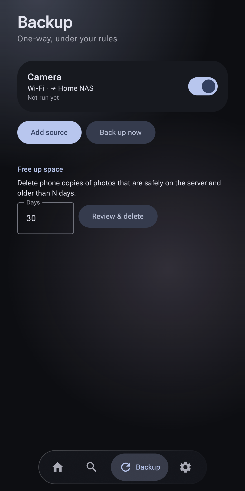
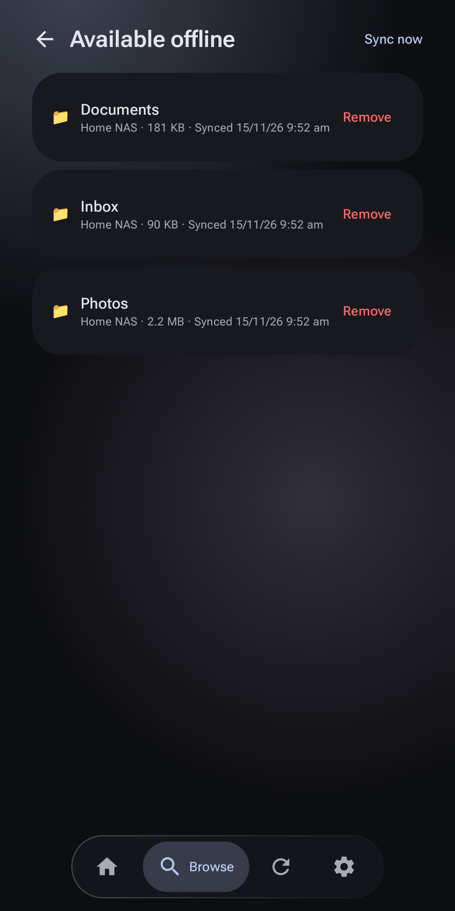
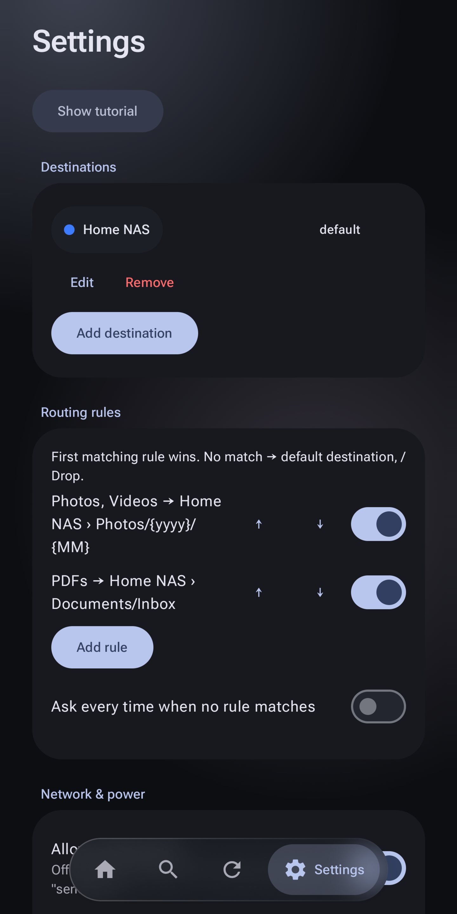
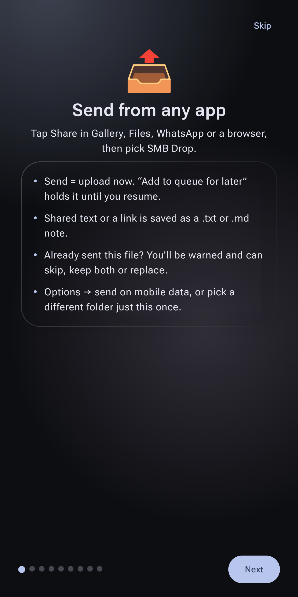

# SMB Drop

**Send, back up and open files on your NAS or PC share from any Android app.**
No cloud, no accounts, no ads, no tracking — your files go only to your own server.

[](https://github.com/tonybenoy/smbdrop/actions/workflows/build.yml)
[](LICENSE)


SMB Drop makes a home or office SMB share (Synology, TrueNAS, Windows, Linux/Samba) feel like part of your phone: share to it from any app, back up to it automatically, and open files from it anywhere Android shows a file picker. It targets people who own a NAS or a PC share and are tired of abandoned, ad-heavy SMB clients.

<table>
  <tr>
    <td align="center"><br><sub><b>Home</b> — status, servers, recent uploads</sub></td>
    <td align="center"><br><sub><b>Share card</b> — routed folder, bookmarks</sub></td>
    <td align="center"><br><sub><b>Queue</b> — resumable, live speed</sub></td>
    <td align="center"><br><sub><b>Browse</b> — thumbnails, bookmarks</sub></td>
  </tr>
  <tr>
    <td align="center"><br><sub><b>Backup</b> — rules per source</sub></td>
    <td align="center"><br><sub><b>Offline</b> — pinned folders</sub></td>
    <td align="center"><br><sub><b>Settings</b> — routing rules</sub></td>
    <td align="center"><br><sub><b>Tutorial</b> — built-in walkthrough</sub></td>
  </tr>
</table>
<sub>Screenshots were taken against a throwaway demo server with made-up files; the system status bar is cropped out.</sub>

## Features
- **Share from any app** — one photo, 200 photos or a 4 GB video; shared text and links become notes; warns when you send a file twice (skip / keep both / replace).
- **Never fails silently** — every file goes into a visible, resumable queue: pause or resume per file, retries with back-off, and uploads continue from the saved offset after Wi-Fi loss, a reboot or an app kill. Clear messages for wrong passwords, full disks and offline servers.
- **Routing rules and bookmarks** — route by file type, extension or source app with `{yyyy}/{MM}/{dd}` templates; bookmark folders and pick them in one tap from the share card.
- **Automatic backup** — camera, screenshots or any folder; Wi-Fi only, charging only, chosen networks, minimum battery, and a custom time window on chosen days. Never uploads the same file twice, and can free up phone space once files are verified on the server.
- **Browse, copy, keep offline** — list or grid with photo, video and PDF thumbnails, search, sort, rename / move / delete (with undo), server-to-server copy, and folders available offline.
- **System file picker** — your server appears in Android's own picker, so Gmail, Docs and other apps can open and save files on it.
- **Private by design** — passwords are encrypted with the Android Keystore, optional biometric lock, SMB 2/3 only, no analytics, no network traffic except to the server you configure.
- **Liquid-glass design** with Material You colours, dark mode, and a frosted fallback on older or low-RAM phones.
- **Translations** — English, Español, Deutsch, Français, हिन्दी (switchable in Settings).

## Quick start
1. Install the APK (see below) and open the app. It scans your network, or you can type an address (`host` or `host:port`).
2. Sign in (user / guest / `DOMAIN\user`), pick a share, and tap **Test & save**.
3. In any app, tap **Share → SMB Drop**. Files go to the folder your routing rules pick; change it from the share card or bookmark your favourite folders.
4. Optional: **Backup → Add source** for your camera, then set Wi-Fi / charging / time-window rules in Settings.

## Install
| Source | Status |
| --- | --- |
| **GitHub Releases** | Signed APK on the [Releases page](https://github.com/tonybenoy/smbdrop/releases) |
| **F-Droid** | Metadata is ready ([`fastlane/`](fastlane), [`fdroid/`](fdroid)); not submitted yet |
| **Google Play** | Listing material is ready ([`store/`](store)); not published yet |

## Build from source
```bash
# JDK 17+ (21 recommended) and the Android SDK (compileSdk 36)
echo "sdk.dir=$ANDROID_HOME" > local.properties
./gradlew :app:testDebugUnitTest :app:assembleDebug      # debug APK in app/build/outputs/apk/debug
./gradlew :app:assembleRelease :app:bundleRelease        # release APK / AAB (needs keystore.properties to sign)
```
Without `keystore.properties`, release builds are signed with the debug key — fine for local testing, not for publishing. Publishing notes are in [`store/release-checklist.md`](store/release-checklist.md).

## How it works
Single `app` module; packages mirror the design in [`docs/PLAN.md`](docs/PLAN.md):

| Package | Responsibility |
| --- | --- |
| `smb` | smbj wrapper, connection pool, errors mapped to user-facing categories |
| `transfer` | queue, `TransferWorker` (upload / download / server-to-server copy, resume, retries), conditions, offline sync |
| `routing` | rule evaluation, path templates, file-name sanitising |
| `backup` | source scanning, de-duplication |
| `discovery` | mDNS + port-445 sweep, reachability |
| `provider` | `DocumentsProvider` for the system file picker, thumbnail cache |
| `share` | share-sheet activity |
| `data` | Room database, DataStore settings, Keystore wrapper |
| `ui` | Compose screens, glass theme, tutorial, translations |

Good to know: servers on a non-standard port use `host:port`; SMB1 is intentionally unsupported; servers that don't expose share listing (`IPC$`) still work — type the share name by hand.

## Releasing
Releases are automated (`.github/workflows/release.yml`). To publish a new version, edit on GitHub — no local build needed:
1. In `app/build.gradle.kts` raise `versionCode` by 1 and set the new `versionName`.
2. Add `fastlane/metadata/android/en-US/changelogs/<versionCode>.txt` (max 500 characters; it becomes the release notes and the F-Droid changelog).
3. Commit to `main`.

The workflow then runs the tests, builds and signs the APK, checks that they match the version, publishes a GitHub release with checksums and creates the `v<versionName>` tag. F-Droid watches those tags and builds its own copy automatically. **Actions → release → Run workflow** (dry run on) rehearses everything with a throwaway key and publishes nothing. The Play Store bundle (AAB) is signed with a separate upload key and built locally — see [`store/release-checklist.md`](store/release-checklist.md).

## Status and limitations
SMB Drop is a young project (v1.0.0) developed and tested on a single physical device against Samba. Lightly tested or untested so far: video thumbnails, server-to-server copy, undo delete, other Android versions and other NAS brands. Spanish, French and Hindi were written without a native review. Bug reports from real setups are very welcome — please include the app version, Android version and server type.

## Contributing
Issues and pull requests are welcome.
- **Translations:** strings are looked up by their English text. Add or fix a language in `app/src/main/assets/i18n/<code>.json` (keys are the English strings; keep `%1$s`-style placeholders), then register the code in `I18n.languages` and `res/xml/locales_config.xml`.
- **Tests:** `./gradlew :app:testDebugUnitTest` (routing, templates and name handling are unit-tested).
- **Screenshots:** `tools/capture-screenshot.sh` crops the status bar so nothing personal leaks. Only photograph a build connected to demo data, never your real server.

## Privacy
The app collects nothing. Files and credentials go only to the server you configure. Full text: [tonybenoy.github.io/smbdrop/privacy.html](https://tonybenoy.github.io/smbdrop/privacy.html).

## License
[Apache License 2.0](LICENSE).

## Credits
[smbj](https://github.com/hierynomus/smbj) (SMB protocol), [Haze](https://github.com/chrisbanes/haze) (backdrop blur), [Bouncy Castle](https://www.bouncycastle.org/), Roboto Flex (SIL Open Font License), and AndroidX / Jetpack Compose.
